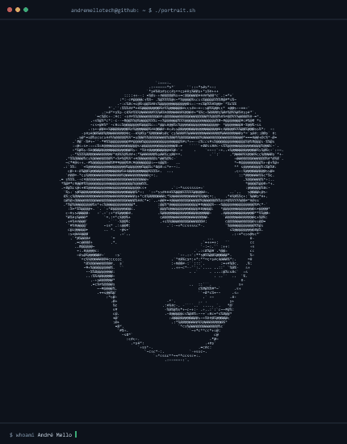
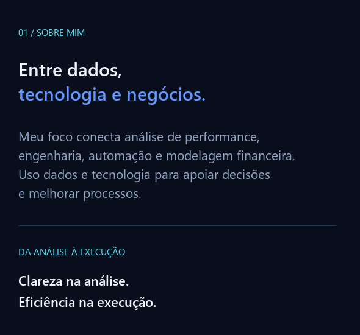
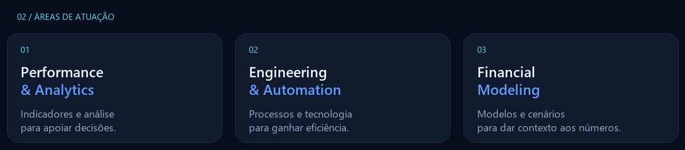
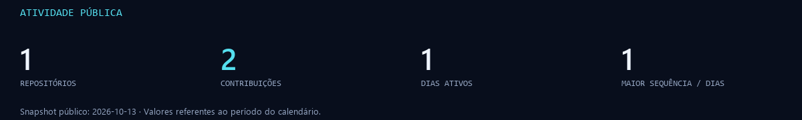

  

<picture><source media="(prefers-reduced-motion: reduce)" srcset="./assets/andre-ascii.png"></picture>

  

 

<h3>Dados & Automação</h3>

   

<h3>Negócios & Apresentações</h3>

 

Office 365 no trabalho com Excel e PowerPoint.

<h3>Linguagens · Conhecimentos</h3>

   

<h3>Versionamento & Projetos</h3>

<h3>Bancos de dados · Experiência anterior</h3>

MySQL aplicado ao desenvolvimento de servidores de Tibia e GTA V / FiveM.

 

<h3>Contato & Projetos</h3>

Conheça meu trabalho e vamos conversar.

&nbsp;

Sobre mim — versão em texto

<h3>André Mello</h3>

Meu foco conecta análise de performance, engenharia, automação e modelagem financeira. Uso dados e tecnologia para apoiar decisões e melhorar processos.

<ul>
<li><strong>Performance & Analytics:</strong> indicadores e análise para apoiar decisões.</li>
<li><strong>Engineering & Automation:</strong> processos e tecnologia para ganhar eficiência.</li>
<li><strong>Financial Modeling:</strong> modelos e cenários para dar contexto aos números.</li>
<li><strong>Dados e automação:</strong> Power BI, Python, Excel e Alteryx.</li>
<li><strong>Negócios e apresentações:</strong> SAP, PowerPoint e Office 365.</li>
<li><strong>Conhecimentos em linguagens:</strong> HTML, CSS, JavaScript e Lua.</li>
<li><strong>Versionamento e projetos:</strong> GitHub.</li>
<li><strong>Experiência anterior com MySQL:</strong> desenvolvimento de servidores de Tibia e GTA V / FiveM.</li>
</ul>

Atividade pública no GitHub

